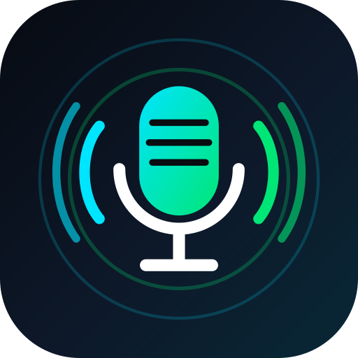

<p align="center">
  
</p>

<h1 align="center">OndaMic</h1>
<h3 align="center">Seu Android vira um microfone • Your Android becomes a microphone</h3>

<p align="center">
  
  
  
  
  
  
</p>

---

## 📌 Visão Geral

O **OndaMic** é um aplicativo Android nativo de código aberto projetado para transformar qualquer smartphone moderno em um **microfone profissional de mão, amplificador de voz e sistema de locução ao vivo** conectado a caixas de som via **cabo P2 (Auxiliar), USB-C DAC ou Bluetooth (A2DP / LE Audio)**.

Diferente de utilitários genéricos, o OndaMic opera em ponto flutuante de 32-bit (PCM Float), integrando controle de hardware do Android 15/16, processamento de chamada (`VOICE_COMMUNICATION` com supressão de eco/ruído da fabricante) e proteção ativa contra microfonia.

---

## ⚖️ Comparativo: Por que o OndaMic foi criado?

Ao pesquisar os aplicativos de microfone mais baixados na Google Play Store (como *WO Mic*, *Megaphone*, *Live Microphone*, *Bluetooth Mic*), identificamos um padrão comum de problemas e limitações que motivaram o nascimento do OndaMic:

| Critério / Recurso | Apps Mais Baixados da Play Store | OndaMic |
| :--- | :--- | :--- |
| **Monetização & Anúncios** | Banners na tela inteira, popups com som antes de falar e paywalls para liberar recursos básicos. | **100% Gratuito, Zero Anúncios, Sem Paywalls**. |
| **Privacidade & Rede** | Exigem permissão de `INTERNET`, coletando dados de telemetria, identificadores de anúncios e tráfego analítico. | **Privacidade Absoluta**: **Sem permissão `INTERNET`** no manifesto. O áudio nunca sai do aparelho. |
| **Pipeline de Chamada / Voice Focus** | Usam apenas captura genérica `MIC`, sem explorar algoritmos de cancelamento de eco e foco de voz do chip. | **Alternância Inteligente**: Suporta `VOICE_COMMUNICATION` (com Hardware AEC, NS, AGC e Foco de Voz OEM da Samsung/Pixel) e Estúdio Baixa Latência. |
| **Modo Estéreo Dual-Mic** | Não disponível ou limitado a mono duplicado. | **Estéreo Dual-Mic Real**: Transmite microfones físicos separados nos canais Esquerdo (L) e Direito (R) com balanço estéreo. |
| **Proteção contra Microfonia** | Inexistente ou apenas um aviso genérico. | **Escudo Completo**: Auto-Notch FFT (corte cirúrgico automático de apitos), inversão de fase 180°, Noise Gate, HPF e Limitador de segurança. |
| **Segurança para Equipamentos** | Desconectar o cabo P2 transfere o som em volume máximo para o alto-falante, gerando estalo e microfonia violenta. | **Kill-Switch Anti-Acidente**: Pausa e muta instantaneamente se o cabo P2 soltar ou a caixa Bluetooth cair. Envelope anti-estalo de 25ms. |
| **Internacionalização (Idiomas)** | Apenas Inglês ou traduções mecânicas em 2 a 5 línguas ocidentais. | **36+ Idiomas Nativos**: Inclui Português, Inglês, Espanhol, Francês, **Crioulo Haitiano**, **17 idiomas africanos** e línguas indígenas sul-americanas. |
| **Limitações e Desafios Reais** | Algumas soluções focam em streaming Wi-Fi/PC (ex: WO Mic). | **Limitação Real do OndaMic**: Focado em caixas físicas (P2/BT/USB). Não transmite áudio via TCP/Wi-Fi para PCs, pois não possui permissão de internet. |

---

## ✨ Recursos Principais

### 🎧 Engenharia de Áudio & Hardware
- **Modos de Transmissão**: Mono (1 Mic duplicado em L+R) ou **Estéreo Dual-Mic** (Microfone 1 no Canal L e Microfone 2 no Canal R) com balanço estéreo (Pan) e inversão de canais.
- **Roteamento de Cápsula Físico**: Escolha manual entre Microfone Inferior (Voz/Chamada), Microfone Superior/Traseiro (Câmera), Headset P2, Microfone USB-C ou Bluetooth.
- **Direcionalidade do Feixe Acústico (Beamforming)**: Modos Frontal, Traseiro ou Omnidirecional (`setPreferredMicrophoneDirection`).
- **Controles de Efeitos Individuais**:
  - **Brilho Vocal (Presença)**: Filtro High-Shelf em 4.8 kHz com chave ON/OFF e slider de 0 a 100%.
  - **Reverb Acústico Estéreo**: Simulador de ambiência (Estúdio, Auditório, Arena) com chave ON/OFF e nível de 0 a 100%.
  - **Eco / Delay Vocal**: Linha de atraso com chave ON/OFF, nível de 0 a 100% e tempo de repetição ajustável (80 a 450 ms).
  - **Equalizador de 5 Bandas**: 100 Hz, 350 Hz, 1 kHz, 3.5 kHz e 8 kHz.
- **Escudo Anti-Microfonia (Feedback Destroyer)**:
  - Detecção espectral Goertzel em tempo real para identificação e corte automático de frequências ressonantes.
  - Inversão de fase acústica (180°), Filtro Passa-Alta regulável (40–220 Hz), Noise Gate inteligente e Limitador Brickwall (-1 dBFS em caixas externas e -6 dBFS no alto-falante interno).

### 🎤 Ergonomia para Locução e Palco
- **Modos de Acionamento**: Contínuo (Mãos-Livres), **Push-to-Talk (Segurar para Falar na tela ou no botão físico de volume)** e **VOX (Ativação por Voz)**.
- **Botão Tosse / Mute Rápido**: Silencia momentaneamente a voz durante palestras longas.
- **Gongo de Anúncio ("Ding-Dong")**: Sinal sonoro harmônico de aeroporto/escola para chamar a atenção da plateia.
- **Auto-Ducking de Música**: Reduz automaticamente o volume de músicas em outros aplicativos enquanto você fala.
- **Gravação Local Simultânea**: Salva a apresentação em arquivo WAV PCM no armazenamento local do dispositivo.
- **Modo Palco OLED**: Fundo Obsidian Stage de alto contraste com opção de dimmer para economia de bateria e discrição visual.

---

## 🌐 Suporte Global a Idiomas (36+ Idiomas Nativos)

O OndaMic foi construído pensando na inclusão global, com suporte a `LocaleConfig` do Android 13–16 e seletor interno instantâneo:

- **Américas & Caribe**: Português (Brasil), Inglês, Espanhol, Francês, **Crioulo Haitiano (*Kreyòl Ayisyen*)**, **Guarani (*Avañe'ẽ*)**, **Quechua (*Runasimi*)**.
- **África (17 Idiomas)**: **Suaíli (*Kiswahili*)**, **Hauçá (*Hausa*)**, **Iorubá (*Èdè Yorùbá*)**, **Igbo (*Ásụ̀sụ́ Ìgbò*)**, **Amárico (*አማርኛ*)**, **Oromo (*Afaan Oromoo*)**, **Somali (*Soomaali*)**, **Zulu (*isiZulu*)**, **Xhosa (*isiXhosa*)**, **Africâner (*Afrikaans*)**, **Lingala (*Lingála*)**, **Uolofe (*Wolof*)**, **Quiniaruanda (*Ikinyarwanda*)**, **Malgaxe (*Malagasy*)**, **Chona (*chiShona*)**, **Chichewa (*Chinyanja*)**, **Akan / Twi (*Akan*)**.
- **Europa, Ásia & Oriente Médio (RTL)**: Alemão, Italiano, Holandês, Polonês, Russo, Ucraniano, Turco, **Árabe (*العربية*)**, **Hebraico (*עברית*)**, **Urdu (*اردو*)**, Hindi, Bengali, Indonésio, Tagalo, Vietnamita, Chinês Simplificado, Japonês, Coreano.

---

## 🤖 Disclaimer sobre Conteúdo Gerado / Assistido por Inteligência Artificial

> **Aviso de Transparência e Desenvolvimento com IA**:
> Este projeto foi concebido, arquitetado e implementado em colaboração com modelos avançados de inteligência artificial generativa (Google Gemini / DeepMind Antigravity Coding Agent) em conjunto com o autor humano (`thepreiss`).
> 
> Todos os arquivos de código Kotlin, pipelines DSP em tempo real, configurações Gradle, recursos de internacionalização e documentações técnicas foram revisados, testados por suítes unitárias automatizadas e compilados com sucesso no Android SDK oficial. No entanto, por se tratar de software assistido por IA e código aberto, encorajamos que a comunidade audite, teste em diferentes dispositivos e colabore com melhorias contínuas.

---

## 🏗️ Arquitetura do Repositório

```
OndaMic/
├── app/
│   ├── src/main/
│   │   ├── java/com/ondamic/app/
│   │   │   ├── audio/           # Motor de áudio, DSP, Device Manager, Gravador WAV
│   │   │   ├── data/            # DataStore, LanguageCatalog, Modelos de Presets
│   │   │   ├── service/         # Foreground Service de Microfone & TileService
│   │   │   ├── ui/              # Jetpack Compose Screens, Themes e Modais
│   │   │   └── MainActivity.kt  # Ponto de entrada, interceptação de botões físicos
│   │   └── res/                 # Layouts, ícones adaptativos e 40+ pacotes de strings
│   └── src/test/                # Testes unitários do processador de áudio DSP
├── store_assets/                # Ícone 512x512 e Feature Graphic 1024x500 para Play Store
├── PLAY_STORE_2026_GUIDE.md     # Guia passo a passo de publicação na Play Store (2026)
├── CONTRIBUTING.md              # Diretrizes de contribuição para a comunidade
├── LICENSE                      # Licença de uso livre (MIT)
└── README.md                    # Documentação principal
```

---

## 🚀 Como Compilar e Rodar

1. Clone o repositório:
   ```bash
   git clone https://github.com/thepreiss/OndaMic.git
   cd OndaMic
   ```
2. Execute os testes unitários do motor DSP:
   ```bash
   ./gradlew testDebugUnitTest
   ```
3. Compile o arquivo APK:
   ```bash
   ./gradlew assembleDebug
   ```
   O APK de teste será gerado em `app/build/outputs/apk/debug/app-debug.apk`.

---

## 📄 Licença

Este projeto é distribuído sob a licença **MIT** — livre para uso, estudo, modificação e distribuição. Consulte o arquivo [LICENSE](LICENSE) para mais detalhes.
